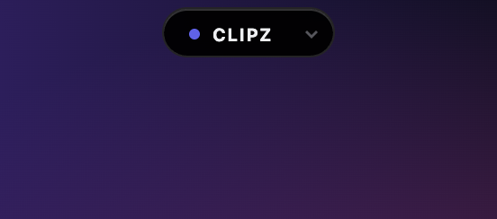
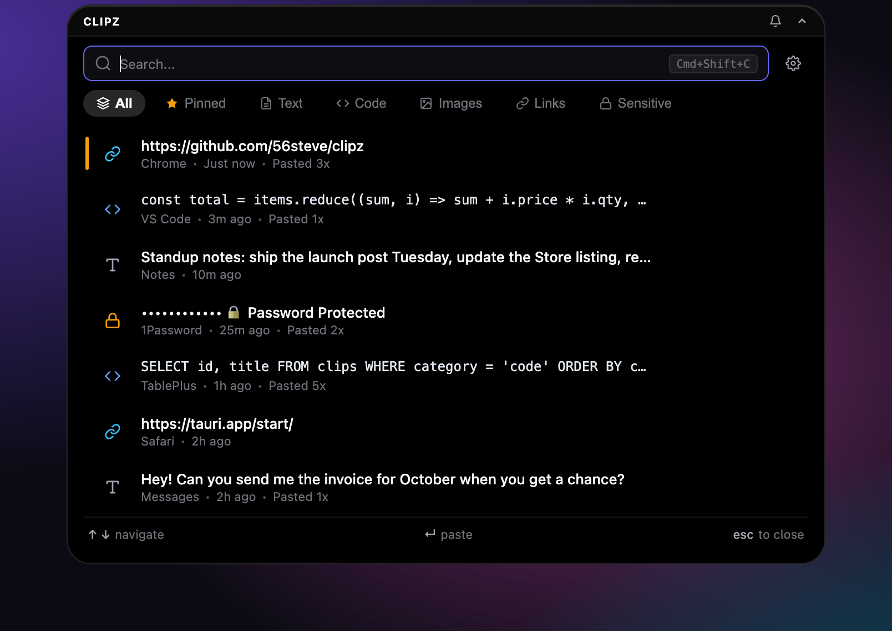
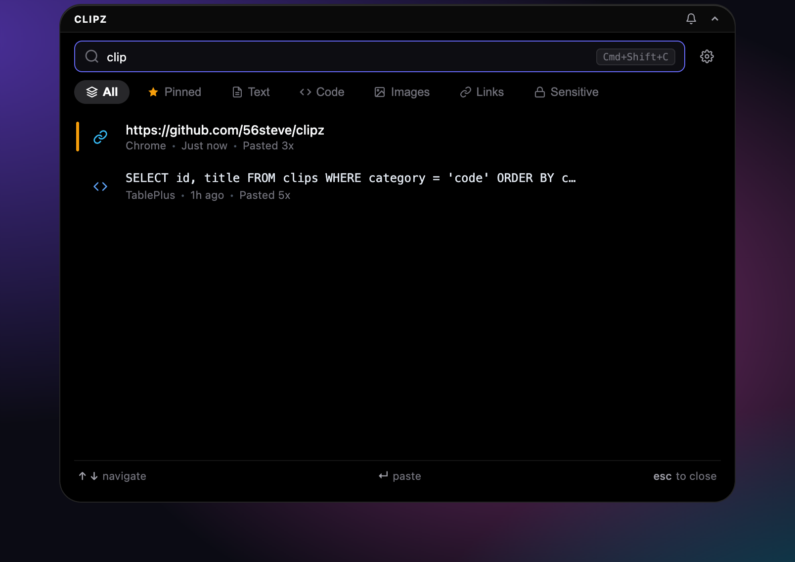
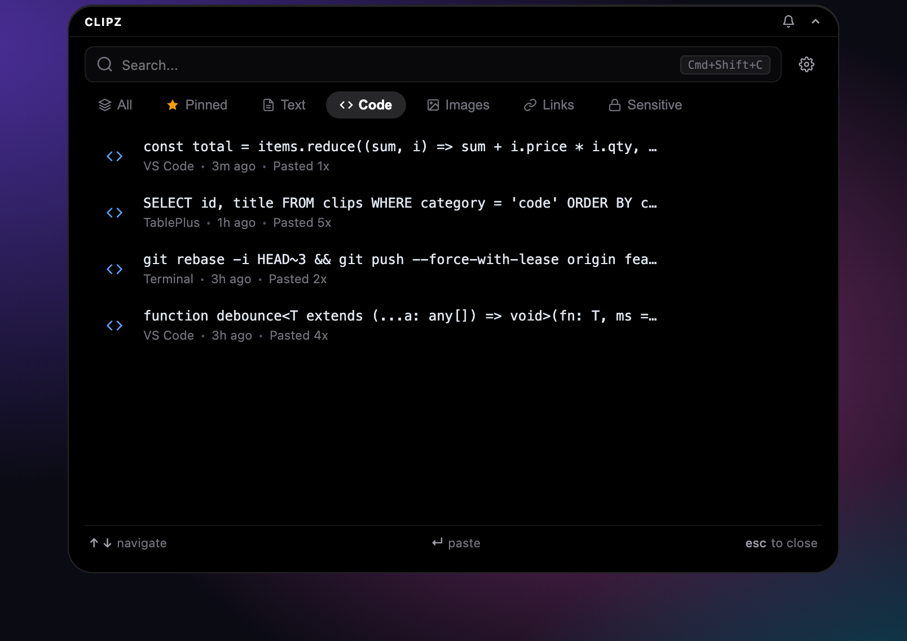
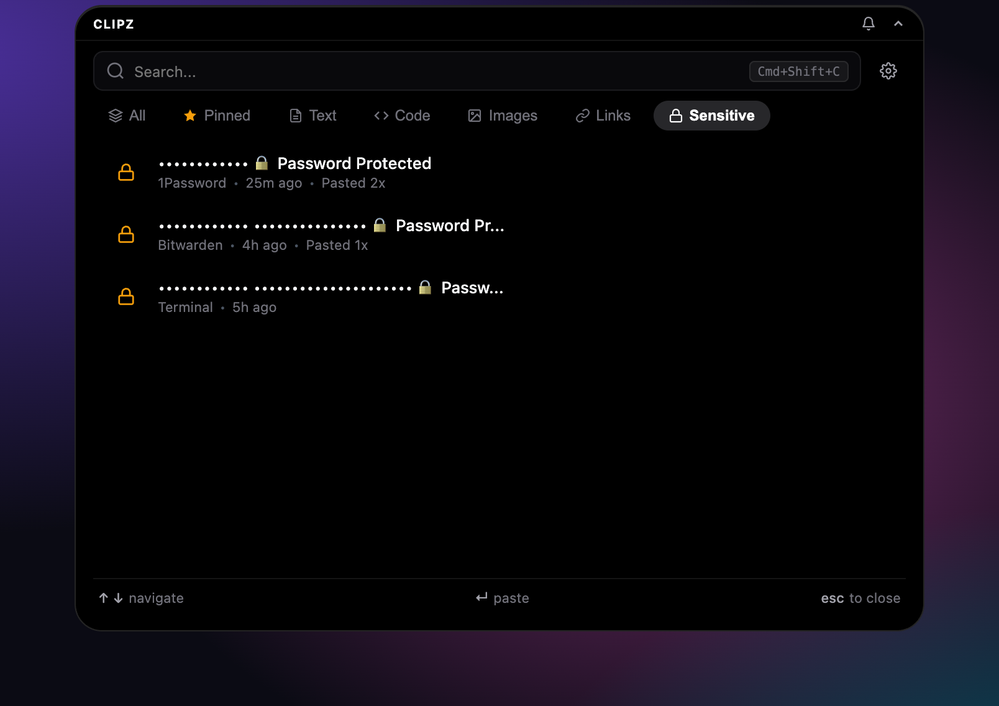

<div align="center">

# Clipz ✂️

### A clipboard manager that lives in your notch.

Searchable history, automatic categorization and encrypted secrets — one hover away on **Windows and macOS**.


<a href="https://apps.microsoft.com/detail/9n02k65s7rmw">
  
</a>

[Download](https://github.com/56steve/clipz/releases/latest) · [Features](#-features) · [Security](#-security) · [Build from source](#-build-from-source)



</div>

---

**Clipz** is a lightweight desktop clipboard manager built around a **Dynamic Island / Top Notch** idea. It listens for clipboard events in real time, categorizes every item, and gives you instant full-text search over your history. Sensitive items are encrypted at rest on both platforms; see [Security](#-security) for exactly what that protects against.

## 📸 Screenshots

| Expanded drawer | Instant search |
|---|---|
|  |  |

| Filters | Sensitive clips |
|---|---|
|  |  |

---

## ⬇️ Download

**Windows:** install Clipz from the Microsoft Store for one-click install and automatic updates.

<a href="https://apps.microsoft.com/detail/9n02k65s7rmw">
  
</a>

Or grab a build from the [**Releases page**](https://github.com/56steve/clipz/releases/latest):

| Platform | File |
|---|---|
| **macOS** (Apple Silicon) | `Clipz_<version>_aarch64.dmg` |
| **Windows** (installer) | `Clipz_<version>_x64-setup.exe` |
| **Windows** (MSIX) | `Clipz_<version>_x64.msix` |
| **Windows** (portable) | `clipz.exe` |

On macOS, grant Clipz **Accessibility** access (System Settings → Privacy & Security) to enable the global keyboard shortcut.

---

## ✨ Features

- 🏝️ **Dynamic Island Notch UI**: Floating top-center interface with smooth glassmorphism styling, hover-to-expand drawer, and keyboard accessibility.
- ⚡ **Real-Time Monitoring**: Low-overhead Rust clipboard loop. On Windows it uses the native clipboard sequence number; on macOS it polls the pasteboard.
- 🔍 **SQLite FTS5 Full-Text Search**: Instant search across your entire clipboard history.
- 🏷️ **Smart Categorization & Filters**: Auto-detects plain text, code snippets, web URLs, and sensitive credentials/passwords.
- 🛡️ **Encrypted Sensitive Clips** (details in [Security](#-security)): sealed with DPAPI on Windows and AES-256-GCM on macOS, with RAM cleanup after 60 seconds.
- 🎯 **Paste Tracking & Source Apps**: Tracks active target windows and source applications.
- ⌨️ **Keyboard & Power User Friendly**:
  - `Arrow Up` / `Arrow Down`: Navigate clipboard history
  - `Enter`: Instant copy selected clip to active clipboard
  - `Esc`: Collapse notch drawer
  - Filter pills for quick focus (`All`, `Text`, `Code`, `Links`, `🔒 Sensitive`)

---

## 🔒 Security

- **Windows**: sensitive items are sealed with the native Data Protection API (DPAPI). The key belongs to your Windows account and never touches the disk.
- **macOS**: sensitive items are sealed with AES-256-GCM. The key lives in `secret.key` next to the database, readable only by your user account (`0600`).
- **No passwords**: neither platform ever asks you for a password.
- **RAM TTL protection**: sensitive clip memory is cleaned up after 60 seconds.
- **What this does not stop**: software already running as you can ask the OS to unseal a clip, exactly as Clipz does. Encryption at rest protects the database file itself — in backups, on a shared disk, or in another account's hands.

See [PRIVACY.md](PRIVACY.md) for what Clipz does and does not collect.

---

## 💾 Where your clips are stored

The database lives in the per-user data folder for the platform, never beside the executable:

| Platform | Location |
|---|---|
| **Windows** | `%APPDATA%\clipz\clipz.db` |
| **macOS** | `~/Library/Application Support/Clipz/clipz.db` |
| **Linux** | `$XDG_DATA_HOME/clipz/clipz.db`, else `~/.local/share/clipz/clipz.db` |

Delete that folder to wipe your clipboard history. The file is a plain SQLite database: ordinary clips are stored as-is and anyone with access to your account can read them. Sensitive clips are the exception — only the `🔒 Password Protected` mask is stored in plain text, with the secret held sealed alongside it.

---

## 🛠️ Technology Stack

| Layer | Technology |
|---|---|
| **Frontend** | HTML5, Modern CSS3 (Vanilla Glassmorphism), TypeScript |
| **Build Tooling** | Vite, TypeScript compiler (`tsc`) |
| **Desktop Framework** | Tauri v2 (`@tauri-apps/api`, `@tauri-apps/cli`) |
| **Backend Core** | Rust, `windows` crate (Win32 API integration) |
| **Database** | SQLite3 with FTS5 (`rusqlite`) |
| **Security** | Windows DPAPI · AES-256-GCM on macOS with an owner-only key file |

---

## 🧰 Build from source

### Prerequisites

1. **Node.js** (v18.x or higher) & `npm`: [Download Node.js](https://nodejs.org/)
2. **Rust Toolchain** (1.75+): [Install Rustup](https://rustup.rs/)
3. **Platform build tools**:
   - **Windows**: Microsoft Visual C++ Build Tools (Visual Studio "Desktop development with C++" workload).
   - **macOS**: Xcode Command Line Tools (`xcode-select --install`).

### Clone and run

```bash
git clone https://github.com/56steve/clipz.git
cd clipz
npm install
npx tauri dev
```

*Or run the Vite frontend preview only:*

```bash
npm run dev
```

### Build a production bundle

```bash
npx tauri build
```

---

## 📁 Directory Structure

```
clipz/
├── index.html            # Main Notch HTML Shell
├── styles.css            # Dynamic Island & Glassmorphism Styles
├── tsconfig.json         # TypeScript configuration
├── vite.config.ts        # Vite build & bundle configuration
├── package.json          # Node dependencies & NPM scripts
├── README.md             # Project documentation
├── docs/screenshots/     # Images used in this README
├── src/                  # Frontend Application Logic
│   └── main.ts           # Clipz UI event listeners & Tauri invoke bindings
└── src-tauri/            # Tauri Rust Backend & native integration
    ├── Cargo.toml        # Rust dependencies & metadata
    ├── tauri.conf.json   # Tauri v2 window & permissions config
    └── src/
        ├── main.rs       # Entrypoint
        ├── lib.rs        # Tauri setup & command router
        ├── clipboard.rs  # Clipboard monitoring thread
        ├── db.rs         # SQLite FTS5 database engine
        ├── paste_tracker.rs # Foreground window & paste detector
        └── security.rs   # Sensitive-clip detection and encryption at rest
```

---

## 🌳 Branching & Workflow

- `main`: Stable release branch.
- `development`: Active feature development branch.

---

## 🤝 Contributing

Issues and pull requests are welcome. If Clipz is useful to you, a ⭐ on the repo helps others find it.

---

## 📄 License

This project is licensed under the [MIT License](LICENSE).
